<div align="center">


# Wayfinder

**Find your way, beautifully.**

A premium navigation app built with **Kotlin Multiplatform** and **Compose Multiplatform**.
Search, multi-stop routing and turn-by-turn navigation on open map data, with one shared codebase for Android and iOS.


[](https://github.com/nijobenny/Wayfinder/actions/workflows/ci.yml)


</div>

---

## 📱 Screenshots

| Live map | Nearby search | Place card | Trip planner |
|:---:|:---:|:---:|:---:|
| 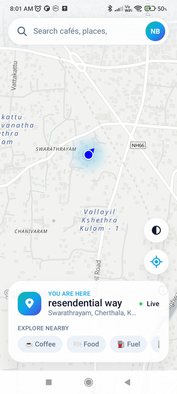 | 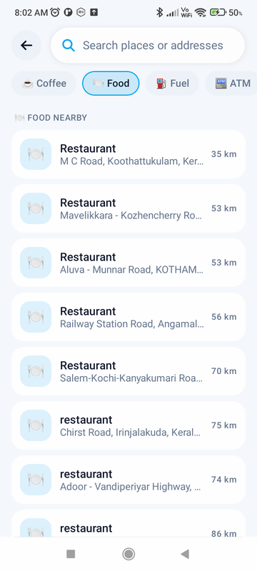 | 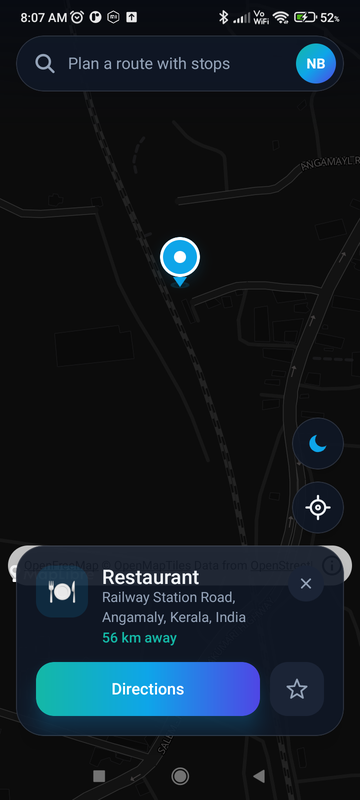 | 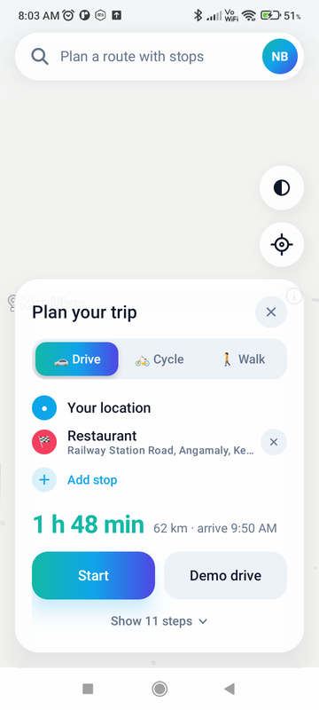 |

| Turn-by-turn steps | Navigation (demo drive) | Night navigation | Dark map |
|:---:|:---:|:---:|:---:|
| 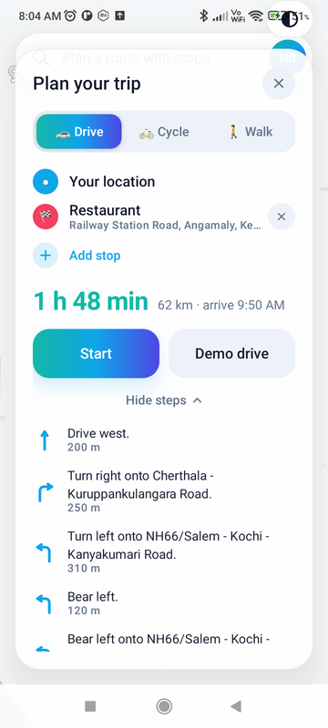 | 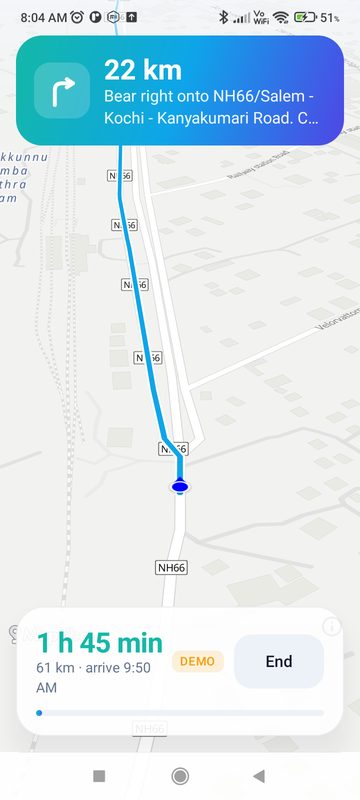 | 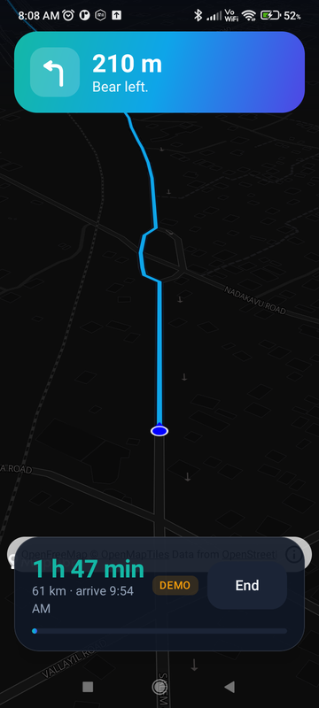 | 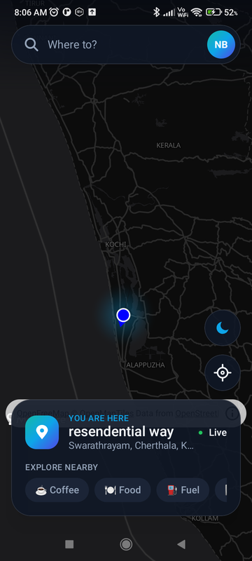 |

| Profile & achievements | Profile (light) | Settings | Splash |
|:---:|:---:|:---:|:---:|
| 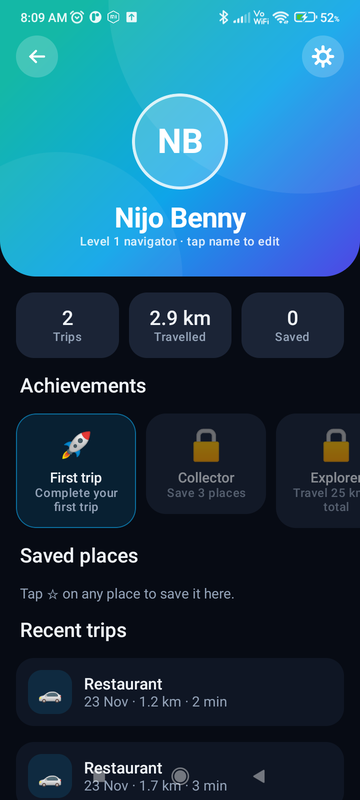 | 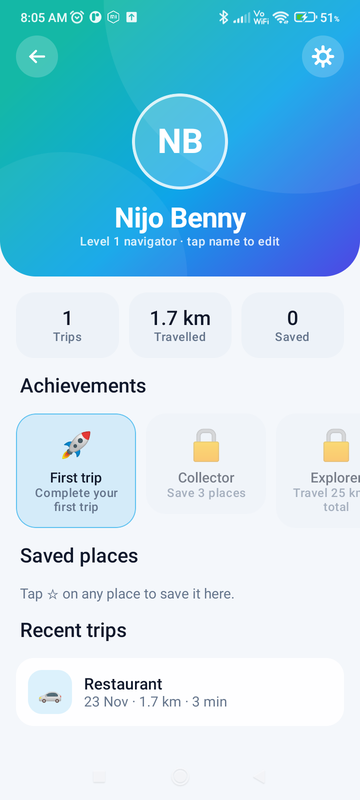 | 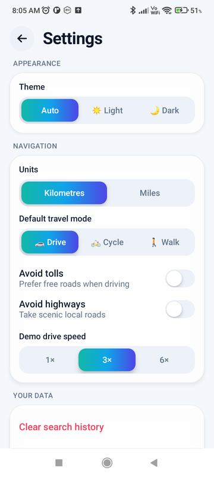 | 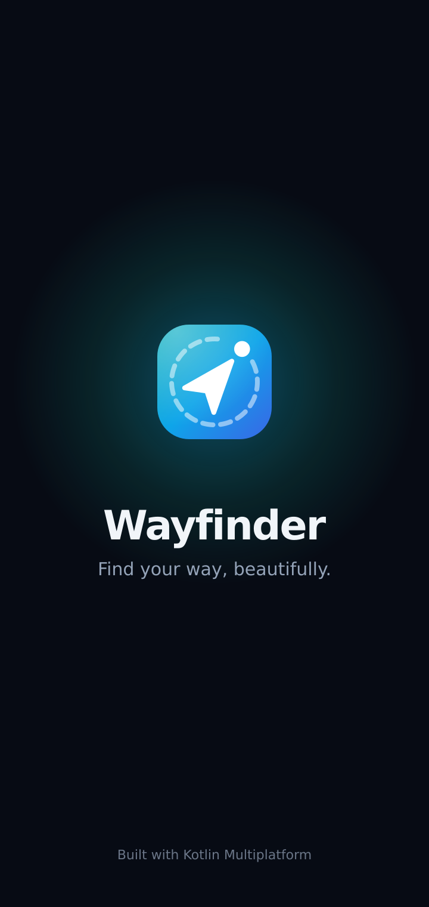 |

## ✨ Features

### 🔎 Search
- **Live autocomplete**: results while you type (debounced, biased towards your location) via **Photon / OpenStreetMap**.
- **Category chips**: ☕ Coffee, 🍽 Food, ⛽ Fuel, 🏧 ATM, 🏥 Hospital and 🏨 Hotel. These run a true radius search on OpenStreetMap via the **Overpass API** (2 km, widening to 6 and 15 km in quiet areas) and are sorted by distance.
- **Recents & saved places** on the empty search screen, a shimmering loading skeleton and staggered, animated results.

### 🧭 Routing (like Google Maps)
- **From your location to any destination**: car, bike or walk, powered by the open **Valhalla** routing engine.
- **Multi-stop trips**: add up to 5 stops, then **reorder** or remove them on a timeline. The route recalculates instantly.
- **Route summary**: distance, duration and arrival time, plus an expandable list of turn-by-turn steps.
- **Preferences**: avoid tolls and avoid highways.
- **Animated route line** that draws itself, and the camera fits the whole trip.

### 🚗 Turn-by-turn navigation
- **Live GPS navigation**: your position snaps onto the route, and a tilted camera follows you.
- **Next-turn banner** with a maneuver arrow and the distance to the turn, plus remaining time, distance and ETA.
- **Demo drive mode** 🎬 drives the route automatically at 1×, 3× or 6× speed, so you can try navigation from your desk.
- **Arrival celebration** with confetti, and the trip is saved to your history.

### 📍 Map
- **MapLibre vector map** with OpenFreeMap tiles: no API key and no billing.
- **Long-press anywhere** to drop a pin with a bounce animation and haptics. Its address is resolved automatically.
- **Place card**: get directions, add it as a stop, or ☆ save it.
- Live location puck, follow mode and fly-to camera animations.

### 👤 Profile
- **Animated gradient header** with your initials, an editable name and a **navigator level**.
- **Stats**: trips taken, distance travelled and places saved.
- **Achievements** 🏆 (First trip, Collector, Explorer, Road warrior, Eco rider…), which unlock with a pop animation.
- Your saved places and recent trips.

### ⚙️ Settings
- Theme (Auto / Light / Dark), units (km / miles) and default travel mode.
- Avoid tolls / highways, and demo drive speed.
- Clear search history or trip history.
- About & open-data attribution.

### 🎨 Premium look & motion
- **Animated splash**: the Android 12+ SplashScreen API hands over to a Compose intro (lifting logo, spinning route ring, light sweep).
- **Adaptive app icon**, with a themed (monochrome) variant for Android 13+.
- **Frosted glass UI** with a bottom sheet that morphs between Explore, Place, Planner and Navigation, springy press feedback and slide transitions between screens.
- Theme changes cross-fade every colour **and the map style**.
- **Hand-drawn vector glyphs**: every icon is drawn in Compose Canvas.

## 🛠 Tech Stack

| Area | Technology |
|---|---|
| Language | Kotlin 2.4 |
| Cross-platform | Kotlin Multiplatform (Android + iOS) |
| UI | Compose Multiplatform, Material 3, custom Canvas drawing & animations |
| Maps | MapLibre Compose + OpenFreeMap vector tiles |
| Location | MapLibre Compose location APIs (lifecycle-aware, permission handling) |
| Networking | Ktor client (OkHttp on Android, Darwin on iOS) + kotlinx.serialization |
| Geocoding & search | Photon (OpenStreetMap), Overpass API for nearby places |
| Routing | Valhalla (FOSSGIS server), polyline6 decoding, custom route tracker |
| Persistence | Jetpack DataStore (Preferences, KMP): settings, saved places, recents, trips |
| Dependency injection | Koin |
| Architecture | Clean Architecture (domain / data / ui) + MVVM with `StateFlow` |
| Splash | AndroidX core-splashscreen + Compose intro |
| Testing | `kotlin.test` + `kotlinx-coroutines-test` with fakes |
| CI | GitHub Actions: tests and APK build on every push |

## 🏗 Architecture

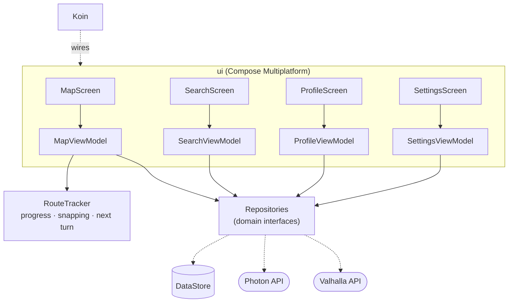

```
shared/src/commonMain/kotlin/com/nijobenny/wayfinder/
├── domain/
│   ├── model/          # Place, Route, Maneuver, TravelMode, UserSettings, TripRecord…
│   ├── repository/     # Settings, Geocoding, Routing, Places (interfaces)
│   └── util/           # GeoMath, Polyline decoder, RouteTracker, formatters
├── data/
│   ├── settings/       # DataStore: settings, saved places, recents, trips
│   ├── remote/         # Ktor client, Photon + Valhalla APIs and DTOs
│   └── repository/     # Implementations (caching, rate limiting)
├── ui/
│   ├── map/            # Map, sheets (explore/place/planner), markers, navigation UI
│   ├── search/         # Search screen + view model
│   ├── profile/        # Profile, stats, achievements
│   ├── settings/       # Settings screen + view model
│   ├── splash/         # Animated intro
│   ├── components/     # Glass panels, controls, glyphs drawn in code
│   └── theme/          # Light/dark palettes with animated transitions
├── di/                 # Koin modules
└── platform/           # expect/actual: time, DataStore path, system bars, back handler
```

## ✅ Tests

- **MapViewModel**: multi-stop routing order and reordering, route preferences, a demo drive that arrives and records the trip, back-button layering, location throttling.
- **Routing math**: polyline decoding (Google reference vector), route progress, GPS snapping, arrival detection, distance and duration formatting.
- **Data**: Photon GeoJSON parsing and fallbacks; **domain**: haversine distance and the theme cycle.

```bash
./gradlew :shared:allTests
```

## 🗺 Roadmap

- [x] KMP foundation, Koin, Ktor, DataStore
- [x] Premium theme system and animated splash + adaptive icon
- [x] Live map, location puck, follow mode, reverse geocoding
- [x] Search with autocomplete and nearby categories
- [x] Multi-stop route planning (car / bike / walk)
- [x] Turn-by-turn navigation + demo drive
- [x] Profile, achievements, saved places, trip history, settings
- [ ] Voice guidance (text-to-speech)
- [ ] Offline map regions
- [ ] Live trip notification

## 🙏 Data & attribution

Map data © [OpenStreetMap](https://www.openstreetmap.org/copyright) contributors · Tiles by [OpenFreeMap](https://openfreemap.org) · Geocoding by [Photon](https://photon.komoot.io) · Nearby places via [Overpass API](https://overpass-api.de) · Routing by [Valhalla](https://github.com/valhalla/valhalla) on the [FOSSGIS](https://www.fossgis.de) server · Rendering by [MapLibre](https://maplibre.org)

## 👤 Author

**Nijo Benny**: Android Developer (Kotlin · Jetpack Compose · Kotlin Multiplatform)

[LinkedIn](https://linkedin.com/in/nijo-benny-81a5a6192) · [GitHub](https://github.com/nijobenny)
