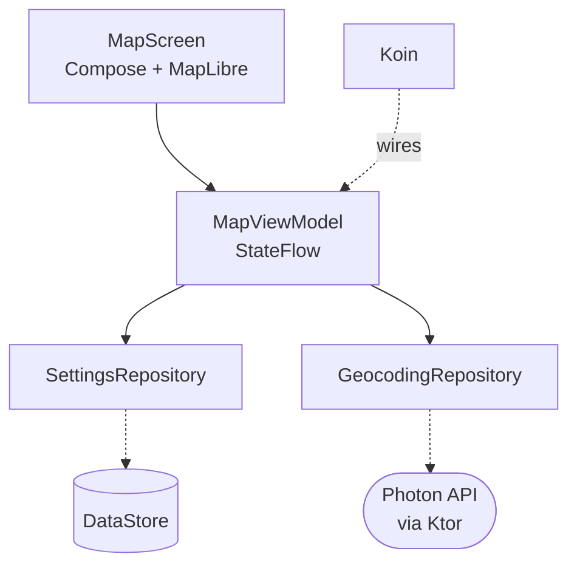

<div align="center">


# Wayfinder

**Find your way, beautifully.**

A premium navigation app built with **Kotlin Multiplatform** and **Compose Multiplatform**.
Live location, a vector map and routing, with one shared codebase for Android and iOS.


[](https://github.com/nijobenny/Wayfinder/actions/workflows/ci.yml)

🚧 *Actively developed, one feature per commit.*

</div>

---

## 📱 Screenshots

| Splash | App icon |
|:---:|:---:|
|  |  |

*Map screenshots coming soon.*

## ✨ Features

### 🗺 Map & location
- **Vector map**: MapLibre with OpenFreeMap tiles. No API key and no billing, just open data from OpenStreetMap.
- **Live location**: a branded location puck with an accuracy halo and heading, plus smooth camera follow that stops as soon as you pan the map.
- **Locate-me button**: a "fly" camera animation back to you, with an icon that shows whether follow mode is on.
- **"You are here" card**: reverse-geocodes your position into a readable place name with **Ktor** and the Photon API. Lookups are rate-friendly (only after you move 150 m) and cached.
- **Permission flow**: a friendly onboarding card, a rationale-aware request, and an "Open settings" fallback after a permanent denial.

### 🎨 Theme handling
- **Three modes**: System, Light and Dark, switched from one animated button (sun, moon and auto icons that morph).
- **Persisted** with Jetpack **DataStore**, shared across Android and iOS.
- **Animated transitions**: every UI colour cross-fades, and the **map style switches too** (Positron in light mode, Dark in dark mode).
- **System bars adapt**, so status-bar icons stay readable in both themes.

### ✨ Premium look & motion
- **Animated splash**: the Android 12+ SplashScreen API hands over seamlessly to a Compose intro with a lifting logo, a spinning dashed route ring, a pulsing arrow, a light sweep and a rising wordmark.
- **Adaptive app icon**: a navigation arrow heading to a waypoint on a dashed route, with a themed (monochrome) icon for Android 13+.
- **Frosted glass UI** floating over the map, with springy press feedback, rotating search hints, a radar pulse while locating and a live GPS indicator.
- **Hand-drawn vector glyphs**: every icon is drawn in Compose Canvas, so no icon library is needed and every icon can be animated.

## 🛠 Tech Stack

| Area | Technology |
|---|---|
| Language | Kotlin 2.4 |
| Cross-platform | Kotlin Multiplatform (Android + iOS) |
| UI | Compose Multiplatform, Material 3, custom Canvas drawing & animations |
| Maps | MapLibre Compose + OpenFreeMap vector tiles |
| Location | MapLibre Compose location APIs (lifecycle-aware, permission handling) |
| Networking | Ktor client (OkHttp on Android, Darwin on iOS) + kotlinx.serialization |
| Geocoding | Photon (OpenStreetMap) |
| Persistence | Jetpack DataStore (Preferences, KMP) |
| Dependency injection | Koin |
| Architecture | Clean Architecture (domain / data / ui) + MVVM with `StateFlow` |
| Splash | AndroidX core-splashscreen + Compose intro |
| Testing | `kotlin.test` + `kotlinx-coroutines-test` with fakes |
| CI | GitHub Actions: tests and APK build on every push |

## 🏗 Architecture



```
shared/src/commonMain/kotlin/com/nijobenny/wayfinder/
├── domain/
│   ├── model/          # Place, ThemeMode
│   ├── repository/     # SettingsRepository, GeocodingRepository (interfaces)
│   └── util/           # GeoMath (haversine distance, coordinate formatting)
├── data/
│   ├── settings/       # DataStore-backed settings
│   ├── remote/         # Ktor client, Photon API + DTOs
│   └── repository/     # Photon geocoding with caching
├── ui/
│   ├── map/            # Map screen, view model, bottom panel, controls
│   ├── splash/         # Animated intro
│   ├── components/     # Glass panels, logo & glyphs drawn in code, bounce click
│   └── theme/          # Light/dark palettes with animated transitions
├── di/                 # Koin modules
└── platform/           # expect/actual: time, DataStore path, system bars
```

## ✅ Tests

- **ViewModel**: theme cycling and persistence, location throttling (no API spam), error and retry.
- **Domain**: haversine distance, coordinate formatting, theme mode cycle.
- **Data**: Photon GeoJSON parsing and fallbacks.

```bash
./gradlew :shared:allTests
```

## 🗺 Roadmap

- [x] KMP foundation, Koin, Ktor, DataStore
- [x] Premium theme system (System / Light / Dark) with animated switching
- [x] Animated splash + adaptive icon
- [x] Live map, location puck, follow mode, reverse geocoding
- [ ] Place search with autocomplete
- [ ] Route planning (car / bike / walk) with route line, distance and ETA
- [ ] Turn-by-turn directions and navigation mode
- [ ] Saved places and trip history
- [ ] Live trip tracking with a notification

## 🙏 Data & attribution

Map data © [OpenStreetMap](https://www.openstreetmap.org/copyright) contributors · Tiles by [OpenFreeMap](https://openfreemap.org) · Geocoding by [Photon](https://photon.komoot.io) · Rendering by [MapLibre](https://maplibre.org)

## 👤 Author

**Nijo Benny**: Android Developer (Kotlin · Jetpack Compose · Kotlin Multiplatform)

[LinkedIn](https://linkedin.com/in/nijo-benny-81a5a6192) · [GitHub](https://github.com/nijobenny)
